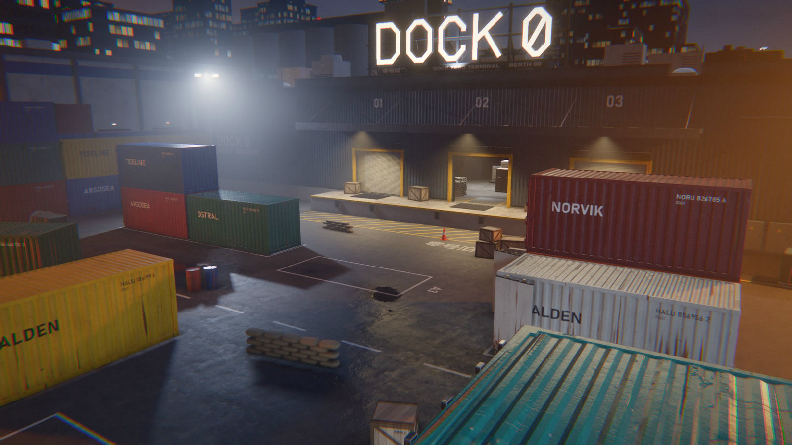
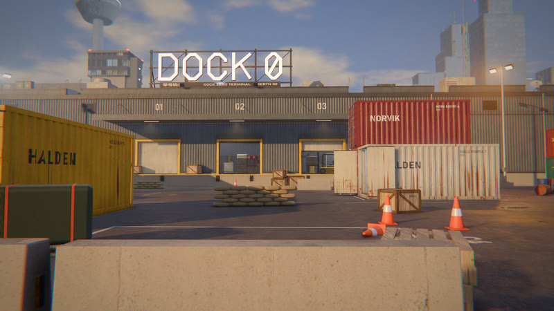
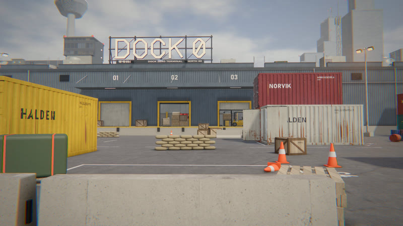
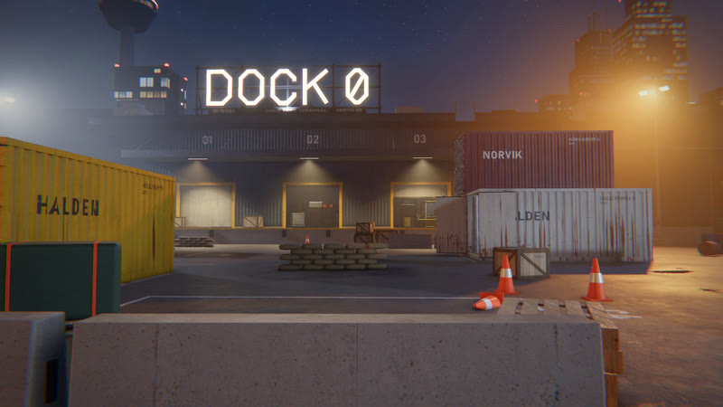
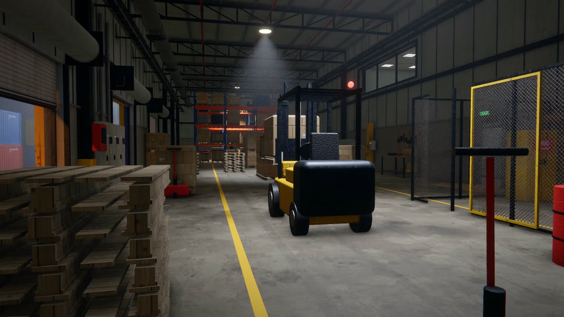
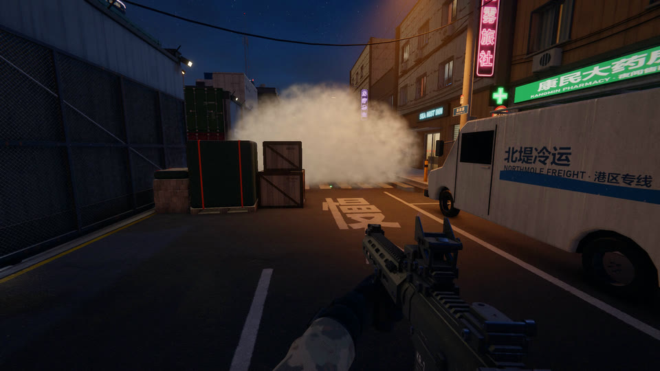
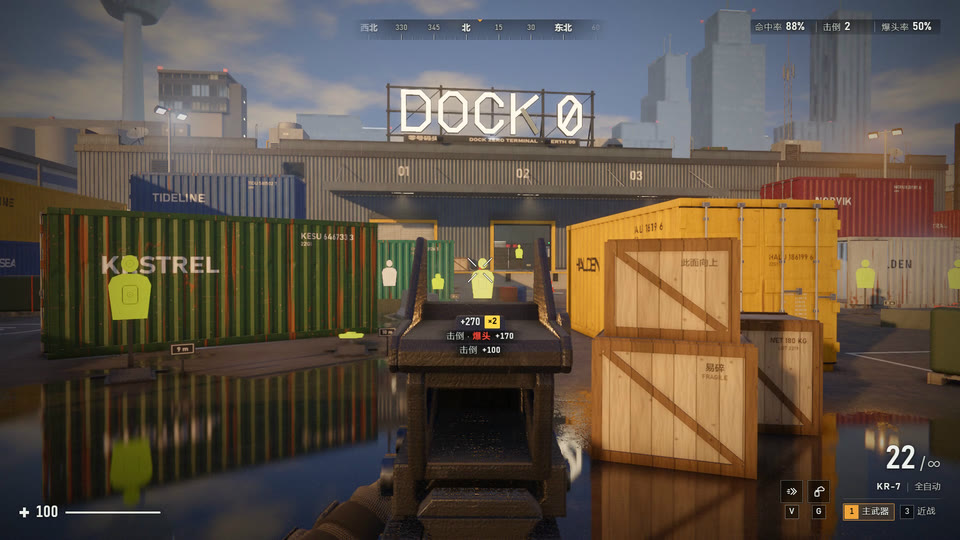
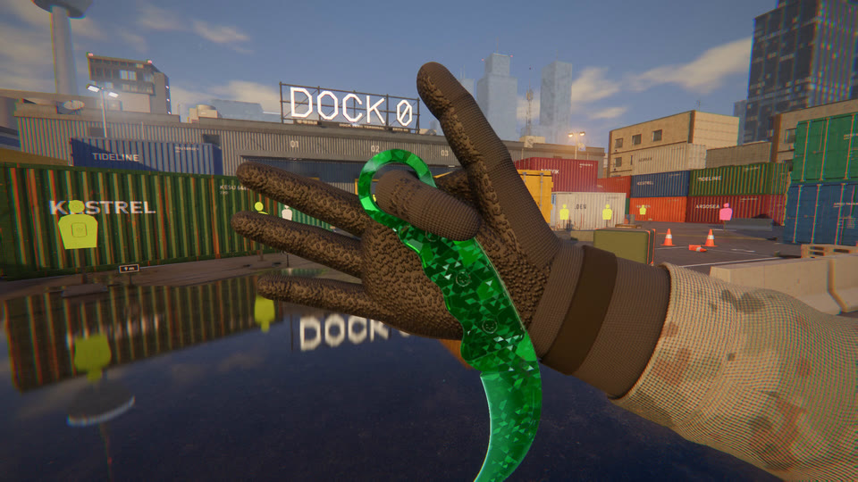
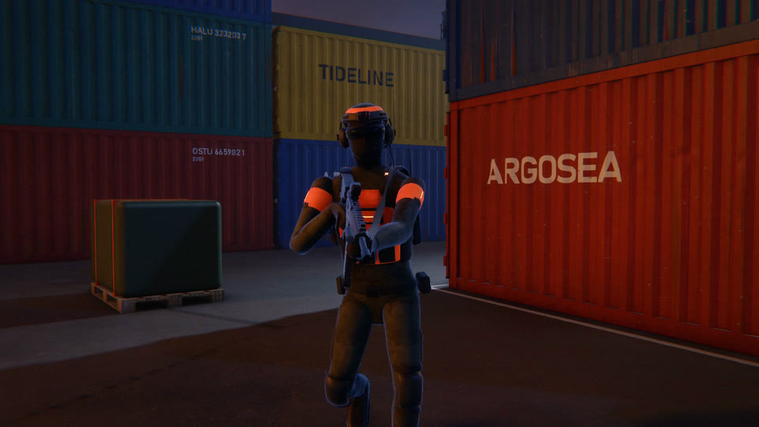
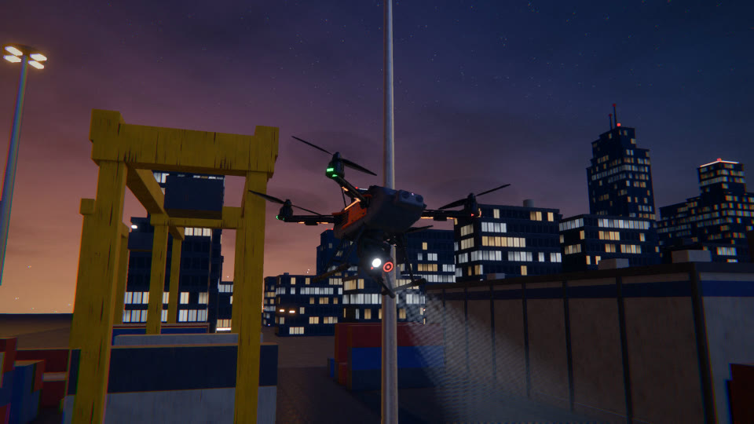

<div align="center">

# 零号码头 DOCK ZERO

浏览器里的 FPS 学习案例：一张码头地图，画面往 3A 的方向做。

只依赖 three.js 和 Vite。几何体、材质、特效和音效都在代码里生成，外部只用了四套照片贴图；代码基本由 Claude 写成。

[](LICENSE)


[在线试玩](https://cyancity.github.io/yolo-mini-fps/) · [快速开始](#快速开始) · [操作](#操作) · [内容](#内容) · [画面是怎么出来的](#画面是怎么出来的) · [这个项目是怎么写出来的](#这个项目是怎么写出来的) · [素材与许可](#素材与许可)



</div>

> DOCK ZERO is a browser FPS built as a study case: how close can a web page get to AAA-looking graphics? One dockside map, three times of day, a rifle, a karambit and a smoke grenade, and five zones held by soldiers and drones that you clear one after another. It runs on three.js and Vite with no other dependencies, and geometry, materials, effects and sounds are almost all generated in code. Nearly all of the code was written by Claude. The game UI and the docs are in Chinese.

## 适合谁

想看浏览器里的实时画面能做到什么程度的人，和想看一个基本由 AI 写出来的中等规模项目长什么样的人。

它不是成品游戏：只有一张地图，没有联机对战、剧情和存档，只支持键盘鼠标。

## 快速开始

需要一台带独立显卡的电脑，桌面版 Chrome 或 Edge。

不用安装，点开就能玩：<https://cyancity.github.io/yolo-mini-fps/>。卡的话在地址后加 `?lite`，用最省的配置启动：<https://cyancity.github.io/yolo-mini-fps/?lite>。

在本机跑还需要 Node.js 20.19 及以上的 20.x，或 22.12 及以上：

```bash
git clone https://github.com/cyancity/yolo-mini-fps.git
cd yolo-mini-fps
npm install
npm run dev
```

打开终端里给出的地址（默认 `http://localhost:5173`），加载完点「开始实战」一个区域一个区域地肃清，或者进「练习场」打靶。开始时默认进全屏，F11 切换，设置里可以关。

画质在菜单的设置里选：低、中、高、超高，默认高。卡的话先降画质；用 `http://localhost:5173/?lite` 打开会用最省的配置启动。

`npm run build` 打包到 `dist/`，`npm run preview` 在本机预览打包结果。推到 `main` 的提交由 `.github/workflows/pages.yml` 打包并发布到上面的试玩地址。

## 操作

| 按键 | 动作 | 按键 | 动作 |
|---|---|---|---|
| W A S D | 移动 | 左键 | 开火，持刀时挥砍 |
| 左 Shift | 冲刺（默认按一下切换） | 右键 | 瞄准，持刀时重击 |
| C | 切换下蹲，冲刺中按是滑铲 | R | 换弹 |
| Ctrl | 按住下蹲，冲刺中按是滑铲 | B | 全自动和单发切换 |
| 空格 | 跳 | 1 | 步枪 |
| Q E | 左右探头 | 3 | 爪刀 |
| V 或鼠标前进侧键 | 喷气冲刺 | 滚轮 | 切换武器 |
| F11 | 全屏 | G | 烟雾弹 |
| F3 | 帧率 | ~ | 检视武器 |
| Esc | 暂停 | | |

鼠标灵敏度、开镜灵敏度、视野、冲刺方式、全屏、画质、画面亮度、时段、动态效果、音量和爪刀涂装都在设置里，存在本机。

## 内容

### 一张连通的码头图

集装箱堆场、仓库内部、两层办公楼、楼顶、街道和卸货场连成一张图，约 72 × 69 米，每个区域至少两条进出路线。时段有下午、白天、夜晚三档，在设置里切换。

<table>
<tr>
<td width="33%" valign="top"></td>
<td width="33%" valign="top"></td>
<td width="33%" valign="top"></td>
</tr>
</table>

<table>
<tr>
<td width="50%" valign="top"></td>
<td width="50%" valign="top"></td>
</tr>
</table>

### 武器和移动

步枪带增高架和红点瞄具，有全自动和单发、后坐力、曳光、弹孔和火花。爪刀左键快划、右键重击，按 ~ 检视。突破烟雾弹第二次碰撞时起烟，挡住敌人视线。

移动有冲刺、滑铲、左右探头和八个方向的喷气冲刺。原地能跳上 1.1 米的月台，助跑能上 1.35 米。4 秒没挨打后自动回血。

<table>
<tr>
<td width="50%" valign="top"></td>
<td width="50%" valign="top"></td>
</tr>
</table>

### 敌人和练习场

实战是一串区域目标：堆场、仓库、办公楼、楼顶、街道，再回堆场，一圈圈打下去，直到阵亡，结算肃清的区域数、击倒数和得分。走完一圈算一轮，这一轮的用时、命中率和掉血报到排行榜，在设置里填个名字就能上榜；下一轮敌人更多，第 2 轮起步枪打空一发罚 0.3 秒。武装人员守在目标区域里，不上门找人，要玩家自己打过去；他们会站岗、听枪声、找掩体、探头射击和包抄，步枪打躯干 3 发倒、爆头 1 发。无人机会搜索、开火，被击落时爆炸。

练习场没有敌人，只有固定、移动、弹出三种靶子，弹药不限，显示命中率和爆头率。

<table>
<tr>
<td width="50%" valign="top"></td>
<td width="50%" valign="top"></td>
</tr>
</table>

## 画面是怎么出来的

渲染用 three.js 的 WebGLRenderer，后处理管线是自己写的（`src/engine/pipeline.js`），一帧这样走：


墙、集装箱、车、武器、手臂、敌人都是代码拼出来的几何体，材质是程序化的 PBR，再叠四套 Poly Haven 的照片贴图补细节。音效全部用 Web Audio 合成，仓库里没有音频文件。

几条贯穿全项目的做法：灯的数量固定，闲置的灯把亮度设成 0，不增删也不切显隐，避免着色器重新编译；第一人称武器的深度压在最前面一小段，后处理靠它认出武器像素；物理里没有斜面，上下楼靠台阶。

性能（2026-11-12，RTX 3070，2560 × 1440，夜晚，第 5 波，当时机器上还有别的负载）：中画质 106 到 114 帧，高画质 80 到 99 帧。针对 2K 144 Hz 的优化还没做。

## 目录

| 目录 | 内容 |
|---|---|
| `src/engine` | 渲染管线、输入和物理 |
| `src/gfx` | 程序化贴图和材质 |
| `src/world` | 关卡：`plan.js` 是总平面，堆场在 `yard.js`，`zones/` 是堆场以外的各分区 |
| `src/weapons` | 武器和手臂 |
| `src/enemies` | 无人机、武装人员和练习场的靶子 |
| `src/fx`、`src/audio`、`src/ui` | 粒子和贴花、音效、HUD |
| `src/game` | 玩法、设置 |
| `dev/` | 模型、特效、音效的单独预览页，和量性能、比画面的工具，用法见 [dev/README.md](dev/README.md) |
| `public/assets` | 外部素材，来源和许可见 [public/assets/README.md](public/assets/README.md) |

## 这个项目是怎么写出来的

人只做产品负责人的事：提需求、试玩、提意见、验收。Claude Fable 5.2 在主会话里对齐需求、拆任务、划分文件归属、派子 agent、读改动并亲自验收；Opus 5.5 和 Sonnet 5.5 的子 agent 并行实现和审查。

开工约 14 小时的时候（2026-11-12 15:47）统计过一次：人发了 16 条消息，前后拉起 111 个子 agent，写了约 3.8 万行 JavaScript，用掉 20.2 亿 token。

留在仓库里的过程文件：[AGENTS.md](AGENTS.md) 是给 agent 的项目约定，[PRODUCT.md](PRODUCT.md) 是产品简述和完成标准，[dev/README.md](dev/README.md) 是调试接口和验收命令。

## 现状

- 只在 Windows 的 Chromium 系浏览器上跑过，Firefox、Safari、核显和手机没有验证。
- 没有自动化测试，验收靠真实运行和 `dev/` 里的工具。
- 还在改，敌人的难度和性能都没有定型。

## 素材与许可

代码用 [MIT](LICENSE) 许可。

外部素材只有两组，都是 CC0：Poly Haven 的 5 套 PBR 贴图（用上了 4 套），Mesh2Motion 的 19 个人形动作（已下载，还没接进游戏）。逐条的来源和许可在 [public/assets/README.md](public/assets/README.md)。

几段着色器函数的写法来自公开的第三方实现，作者和许可列在 [THIRD_PARTY_NOTICES.md](THIRD_PARTY_NOTICES.md)。

设定是原创的，不复刻任何现成游戏的名字、地图、角色和美术。非商业的学习项目。
